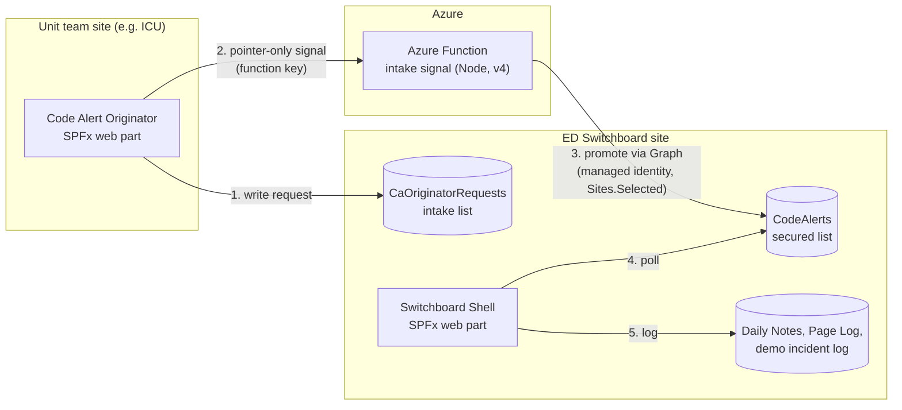

# ED Switchboard: SharePoint Online Operator Console (Proof of Concept)

A working SharePoint Online / SPFx proof of concept for an Emergency Department switchboard operator. It turns the paper forms and phone-list habits of a busy switchboard desk into guided, keyboard-friendly workflows that log themselves.

**[Watch the 7-minute demo video](https://www.youtube.com/watch?v=b44VyWwEeps)**


> All names, phone numbers, locations, and records in this repository are fictional. The hospital is "HOS Demo Hospital," phone numbers use the reserved 555-01xx range, and external systems (EHR chat, incident reporting, on-call rosters) are simulated. No production system is written to and no patient data is used.

## What it does

A switchboard operator handles overhead codes, OR team call-ins, police blood-draw intakes, paging requests, and building alarms, often several at once, under time pressure. This console gives each of those a guided workflow:

- **Code Alerts (23 alert types).** Medical, security, and facility codes such as Code Blue, Stroke Alert, Bomb Threat, Fire Alarm, Infant Abduction, and Emergency Operations Plan. Each opens a full-screen, step-by-step checklist: acknowledge, read the overhead announcement three times, notify the right people with generated scripts, and log the event. Timers show elapsed time. A Code Alert can interrupt any other workflow in progress, such as a DUI intake or a paging request, which then resumes where the operator left off.
- **Offsite alert originator.** A separate web part lets a unit (for example, an ICU team site) send a Code Alert to the switchboard. The request travels through an Azure Function and appears at the switchboard within seconds, with acknowledgement and All Clear flowing back to the unit.
- **OR Team Call-In.** Enter the surgery time and the console loads the on-call team from a roster list, generates the call script, and tracks when each person was reached.
- **DUI Intake, Paging Log, and Alarm Panel.** Structured forms that replace paper logs, with required-field checklists and scripted maintenance calls.
- **Daily Notes.** A living shift log that every workflow writes to automatically, grouped the way operators already read their paper log: recent codes, alarms and maintenance calls, and other notes to pass along.

## Screenshots

<table>
<tr>
<td width="50%"><br><b>Code Alert workflow.</b> A full-screen, step-by-step checklist with an elapsed timer and a copy-ready message for each notification step.</td>
<td width="50%"><br><b>Completed steps compress</b> into a row so the current step stays front and center. The last step logs a simulated incident report.</td>
</tr>
<tr>
<td width="50%"><br><b>Unit team site.</b> The Code Alert Originator web part placed on an ICU page.</td>
<td width="50%"><br><b>Offsite originator.</b> The unit submits an alert location and sees the switchboard's acknowledgement come back in seconds.</td>
</tr>
<tr>
<td width="50%"><br><b>OR Team Call-In.</b> Loads the on-call team for the surgery time, generates the call script, and tracks each contact.</td>
<td width="50%"><br><b>DUI Intake.</b> A structured replacement for the paper intake form, with a required-step checklist.</td>
</tr>
<tr>
<td width="50%"><br><b>Paging Log.</b> Captures who called, who was paged, and the outcome.</td>
<td width="50%"><br><b>Alarm Panel Log.</b> Pick the alarm, get a scripted maintenance call, and log it in one pass.</td>
</tr>
</table>

## Architecture



Key design decisions:

- **Pointer-only signaling.** The Function receives only IDs, never alert details, so nothing sensitive appears in Function logs.
- **Least privilege.** The Function's managed identity uses Microsoft Graph `Sites.Selected` with write access granted to one site only. Units can submit requests but cannot read the secured alert list.
- **Shell-owned popup host.** Modules supply workflow content; the shell owns screen takeover, focus trapping, queueing, interruption, and resume, so every workflow behaves the same way under pressure.
- **Accessible by default.** Keyboard navigation, focus management, and readable foreground colors on every alert color.
- **Independently deployable packages** for the switchboard console, the unit originator, and the Function.

## Tech stack

- SharePoint Online, SharePoint Framework (SPFx) 1.22, SharePoint Lists
- React 17, TypeScript 5.8, Fluent UI 8, SCSS
- Heft and Jest for builds and tests
- Azure Functions (Node.js, v4 programming model, Flex Consumption), managed identity, Microsoft Graph
- Power Automate (earlier fallback promotion flow)

## Repository layout

```text
packages/
  switchboard-core-spfx/   Switchboard console: shell, Daily Notes, Code Alert workflows,
                           OR Call-In, DUI Intake, Paging Log, Alarm Panel
  code-alert-spfx/         Code Alert Originator web part for unit team sites
  code-alert-functions/    Azure Function that promotes unit requests to the switchboard
  or-call-in-spfx/ ...     Placeholders from the original plan; these modules now live
                           inside switchboard-core-spfx
provisioning/              SharePoint list schemas and field notes
test-data/                 Fictional seed data and the demo roster generator
docs/                      Architecture, data model, deployment, and phase notes
```

## Running it

Requirements: Node.js (see each package's `package.json`), a Microsoft 365 developer tenant with a SharePoint app catalog, and an Azure subscription for the Function.

```powershell
cd packages/switchboard-core-spfx
npm install
npm run start   # local dev against your SharePoint site
npm run build   # tests + production .sppkg package
```

Deployment steps, list setup, and the Azure Function configuration are in [docs/SHAREPOINT_DEPLOYMENT.md](docs/SHAREPOINT_DEPLOYMENT.md) and [docs/CODE_ALERT_AZURE_FUNCTION_SIGNAL_SETUP.md](docs/CODE_ALERT_AZURE_FUNCTION_SIGNAL_SETUP.md). The data model is in [docs/DATA_MODEL.md](docs/DATA_MODEL.md).

## How it was built

Designed and built by Matthew Rogers, using AI coding agents (OpenAI Codex) for implementation under written specifications. [AGENTS.md](AGENTS.md) and the phase plans in [docs](docs) are the working agreements those agents followed.

## Status

Proof of concept, demo-ready. The switchboard console, all workflows, and the offsite originator path are complete and verified on a developer tenant.
